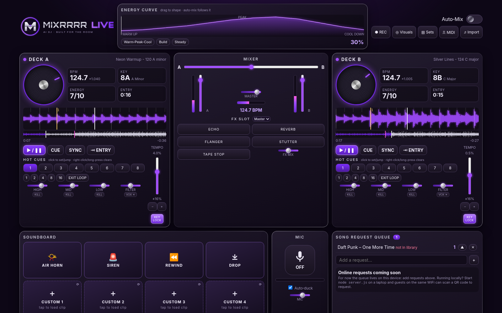

# Mixrrrr Live: browser AI DJ

**Live app:** https://anthony07-max.github.io/mixrrrr-live/
**Try it with demo tracks:** https://anthony07-max.github.io/mixrrrr-live/?demo&autoload

A two-deck DJ app that runs in the browser. Drop in your own music files and it works out each track's BPM, key, energy and best entry point. It then beatmatches and auto-mixes your set, including mid-song blends. Everything is plain HTML/CSS/JS on the Web Audio API, with no build step and no dependencies. Your music is analysed on your device and never uploaded.

## Features
- Two decks with waveforms, cue, sync with continuous beat-phase lock, 8 hot cues, beat loops, 3-band EQ with kills, a filter sweep and a vocal cut
- **Key lock (master tempo)** on by default, so tempo changes don't change the pitch (phase-vocoder time-stretch in an AudioWorklet)
- **Auto-Mix** that orders tracks by key, BPM and an editable energy curve, then mixes them with beatmatched transitions
- FX: echo, reverb, flanger, stutter and tape stop. Soundboard pads, including your own clips
- Mic input with auto-ducking, set recording (WebM/Opus), and a full-screen visuals mode
- Song request queue, saved sets and presets, Spotify playlist matching against your own files, and Web MIDI controllers with MIDI Learn
- Installable PWA that works offline, with a phone-friendly layout

## Run
- **Online:** open the live link above in Chrome or Edge (recommended). You can install it as an app from the address bar.
- **Locally with same-WiFi phone requests:** `node server.js` (port 8080 by default) and open http://localhost:8080. Guests scan the in-app QR code.
- **Any static server:** `python3 -m http.server 8080`. The request queue is then local to that device.
- Demo tracks: add `?demo` to the URL (`&autoload` also loads both decks).

## Song requests
Choose the backend in `config.js` (public values only):
- `requests:'auto'` (default) uses `server.js` when the page is served by it. Otherwise it's a local-only queue with an "online requests coming soon" note, and the app makes no network calls.
- `requests:'server'` with `serverUrl` points at a `server.js` on your network.
- `requests:'firebase'` with a `firebase:{…}` web config is a placeholder for the upcoming shared online queue. Until that's wired in, the app falls back to the local queue.

## Files
`index.html`, `style.css`, `app.js` (engine + UI), `analysis.js` (BPM/key/energy/entry), `stretch-worklet.js` (key lock), `config.js`, `sw.js` + `manifest.webmanifest` (PWA/offline), `server.js` (optional request server, no dependencies), `request.html` (guest page), `qrcode.js` (MIT, Kazuhiko Arase), `demo/` (generated test tracks), `logo.svg`, `icons/`.

## Shortcuts
Q/P play deck A/B · W/O cue · 1–4 sound pads · Shift-click, right-click or long-press a hot cue to clear it.

## Limitations
- Streaming services don't allow their audio to be mixed in third-party apps. The Spotify import only matches pasted track names to your own files.
- Key lock needs http/https (it doesn't work from `file://`). It uses a phase vocoder, so very sharp transients get slightly softer at big tempo changes (more than ~10%). Turn KEY LOCK off for vinyl-style pitch.
- BPM and key are estimates. They work best on steady 4/4 dance music between 75 and 175 BPM.
- Vocal and bass kills are EQ-based, not true stem separation.
- The `server.js` queue is in memory and resets when the server restarts.

## License
MIT. See [LICENSE](LICENSE).
